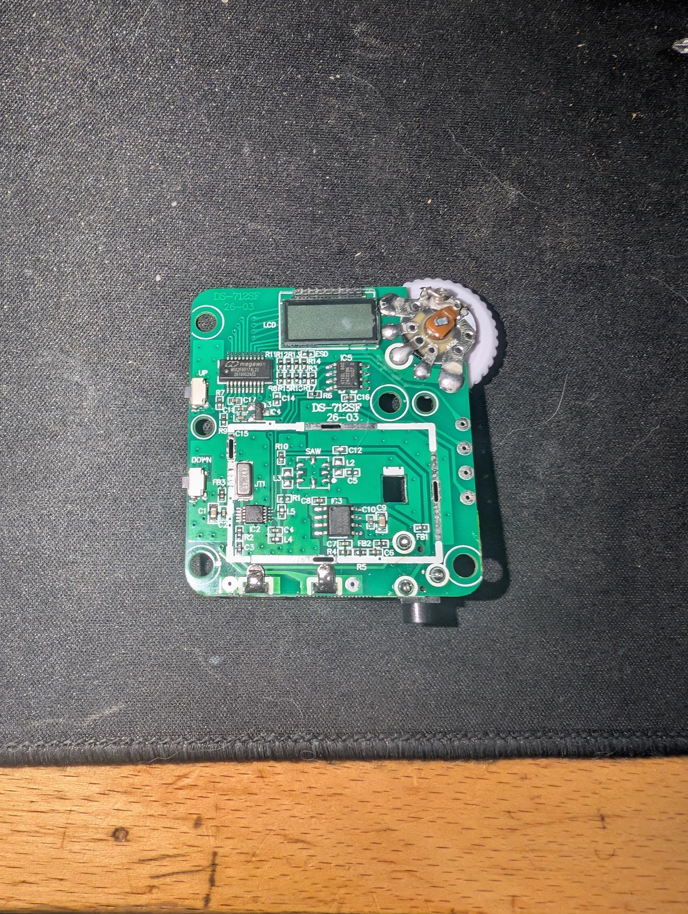
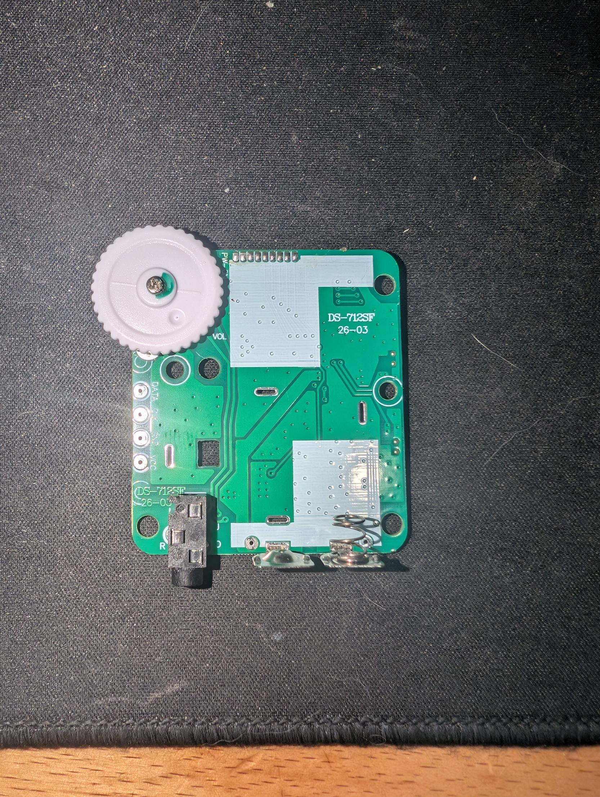

# Amex F1 race radio (US Grand Prix 2026): reverse engineering

The commentary radio handed out at the 2026 US Grand Prix (COTA) has two preset stations (English and Spanish). Holding both buttons switches it to normal FM mode. A normal FM radio can't pick up the commentary, because the stations sit outside the US FM band.

## Result

| Preset | Display | CHAN (RDA5807M reg 0x03) | Frequency |
|---|---|---|---|
| English | E1 | 278 (0x116) | **63.9 MHz** |
| Spanish | E2 | 288 (0x120) | **64.4 MHz** |

- Plain analog wideband FM. The tuner chip can't do anything else.
- Tuner band: 50-76 MHz range, 50 kHz channel spacing. Freq = 50 MHz + CHAN x 0.05 MHz.
- Both are below the US FM broadcast band (87.5-108 MHz), in the old VHF TV channel 3/4 area, so ordinary FM radios can't tune them.
- E1/E2 labels come from the radio's display. **Not yet confirmed by ear or with an SDR.** To check, tune a receiver that covers 50-76 MHz (e.g. an RTL-SDR) to 63.9 and 64.4 MHz, wideband FM, at the track.

## Board: "DS-712SF 26-03"

| Ref | Marking | Role |
|---|---|---|
| IC2 | 5807M TPL24 | RDA5807M single-chip FM receiver (I2C 0x10 / 0x11), 32.768 kHz crystal |
| MCU | Megawin MG82F6D17AL20 | 8051-family MCU: buttons, LCD, preset logic |
| IC5 | ATXBL 602 / 24C02BN | AT24C02 256-byte I2C EEPROM (0x50), stores presets |
| IC3 | 8002A | Mono audio amp to 3.5 mm jack (cord probably doubles as antenna) |
| IC4 | 5KZ0 (SOT-23) | Probably an LDO regulator (unconfirmed) |
| SAW, L2, L3, C5 | | Footprints appear unpopulated (shared PCB design) |

Power is 2xAA. Volume is a 50 kOhm pot with switch. The four through-hole pads on the back (DATA / CLK / GND / VCC) are the I2C bus: DATA = SDA and CLK = SCL, shared by the EEPROM and the RDA5807M tuner. They are the access point used here (see Method).

## Method

### 1. EEPROM dump

ESP32 (classic, GPIO21 SDA / GPIO22 SCL) wired to the back pads, not to the chips: DATA -> GPIO21, CLK -> GPIO22, GND -> GND, **VCC pad left unconnected** (the radio was powered from its own batteries and switched on). Because the pads are the I2C bus shared by the EEPROM and tuner, this reads the EEPROM and also reaches the tuner, with no soldering to IC pins. Read-only sketch in [`eeprom-dump/`](eeprom-dump/). Two dumps matched, so the MCU wasn't interfering with the bus.

I2C scan found 0x10, 0x11 (RDA5807M), 0x50 (EEPROM) and 0x60. 0x60 returns all zeros and looks unused.

Dumps: [`dumps/at24c02.bin`](dumps/at24c02.bin) (binary), [`dumps/at24c02.hex.txt`](dumps/at24c02.hex.txt) (hex), [`dumps/raw1.txt`](dumps/raw1.txt) (raw serial capture).

```
00: A5 1E 28 01 02 00 40 01 6A 22 26 2A 88 27 E8 1C
10: 01 00 F6 18 02 00 28 19 FF FF FF FF FF FF FF FF
50: 77 00 00 00 FF FF FF FF FF FF FF FF FF FF FF FF
60: 36 33 34 35 FF FF FF FF 32 30 32 36 30 37 31 35
80: 70 6F 23 36 33 34 35 41 20 46 4D 1A 35 30 2D 31
90: 30 38 4D 48 7A 20 32 2E 31 56 20 20 FF FF FF FF
```

(Rows that are entirely `FF` are omitted. See the hex file for all 16 rows.)

### 2. EEPROM decode

ASCII strings: `6345`, `20260715` (looks like a build date) and `po#6345A FM\x1a50-108MHz 2.1V` (a 50-108 MHz tuner build).

Little-endian 16-bit values in 10 kHz units from 0x08:

| Offset | Bytes | Value | MHz | Notes |
|---|---|---|---|---|
| 0x08 | `6A 22` | 8810 | 88.10 | likely FM-mode data |
| 0x0A | `26 2A` | 10790 | 107.90 | likely FM-mode data |
| 0x0C | `88 27` | 10120 | 101.20 | likely FM-mode data |
| 0x0E | `E8 1C` | 7400 | 74.00 | unknown (band edge or default?) |
| 0x10 | `01 00` | index 1 | | |
| 0x12 | `F6 18` | 6390 | **63.90** | E1, English |
| 0x14 | `02 00` | index 2 | | |
| 0x16 | `28 19` | 6440 | **64.40** | E2, Spanish |

The header `A5 1E 28 01 02 00 40 01` is not decoded. A preset count of 2 and a magic byte are guesses.

### 3. Live tuner readback (confirmation)

Sketch in [`tuner-read/`](tuner-read/) polls RDA5807M registers 0x03, 0x07 and 0x0A over the same pads (read-only, the ESP32 acts as an I2C master and reads them) while presets are changed. This is active polling, not passive sniffing of the MCU's writes. Passive sniffing of the tuner commands with a logic analyzer on the same pads would also work but was not needed. Logs are in [`dumps/`](dumps/).

- Reg 0x03 = `0x481E` -> CHAN 288, band `11`, spacing `10` (50 kHz) -> 64.4 MHz
- Reg 0x03 = `0x459E` -> CHAN 278, band `11`, spacing `10` -> 63.9 MHz
- Reg 0x07 bit 9 is 0, which selects the 50-76 MHz range (not 65-76).

Preset order test (`dumps/tuner3.log`): radio on E2 at start read CHAN 288 (64.4 MHz). After one Up press to E1 it read CHAN 278 (63.9 MHz).

Note: reg 0x0A (READCHAN) reads 0 right after power-up or retune, before the tuner status latches. Use reg 0x03 CHAN as the commanded frequency.

## RDA5807M reg 0x03 decode

- Bits 15:6 = CHAN
- Bits 3:2 = BAND: `00` 87-108, `01` 76-91, `10` 76-108, `11` 65-76 or 50-76 (reg 0x07 bit 9: 1 = 65-76, 0 = 50-76)
- Bits 1:0 = SPACE: `00` 100 kHz, `01` 200 kHz, `10` 50 kHz, `11` 25 kHz
- Freq = band start + CHAN x spacing

## Photos

Board "DS-712SF 26-03" with the metal shield area at the lower half (RDA5807M, SAW footprint, 8002A amp).

| | |
|---|---|
|  |  |
| Front overview: LCD, MCU, IC5 EEPROM, UP/DOWN buttons, volume pot | Back: DATA / CLK / GND / VCC pads, headphone jack, battery contacts |

More close-ups in [`images/`](images/):

- [`03-mcu-eeprom-lcd.jpg`](images/03-mcu-eeprom-lcd.jpg): Megawin MG82F6D17AL20 MCU, IC5 (ATXBL 602 / 24C02BN), IC4 (5KZ0)
- [`04-eeprom-ic5.jpg`](images/04-eeprom-ic5.jpg): IC5 close-up
- [`05-rda5807m-crystal-ldo.jpg`](images/05-rda5807m-crystal-ldo.jpg): IC2 (5807M TPL24), 32.768 kHz crystal JT1, UP/DOWN buttons
- [`06-eeprom-amp-saw.jpg`](images/06-eeprom-amp-saw.jpg): IC5, 8002A amp, unpopulated SAW/L2/L3/C5
- [`07-front-closeup.jpg`](images/07-front-closeup.jpg): front, closer (shows the A50K pot)
- [`08-amp-saw-rf-section.jpg`](images/08-amp-saw-rf-section.jpg): IC3 (8002A) and the unpopulated SAW area

EXIF metadata was stripped from the photos.

## Repo layout

- `eeprom-dump/` PlatformIO project: scan I2C and dump the 24C02
- `tuner-read/` PlatformIO project: poll RDA5807M registers
- `dumps/` EEPROM dump and serial logs
- `cap.py` serial capture helper (resets the ESP32 and logs with timestamps)
- `images/` board photos

## Open questions

- Confirm 63.9 / 64.4 MHz on-air with an SDR at the next race.
- Meaning of the EEPROM header bytes and the 74.00 MHz value.
- Whether the VCC pad can safely power the board from an external supply (not tested).
